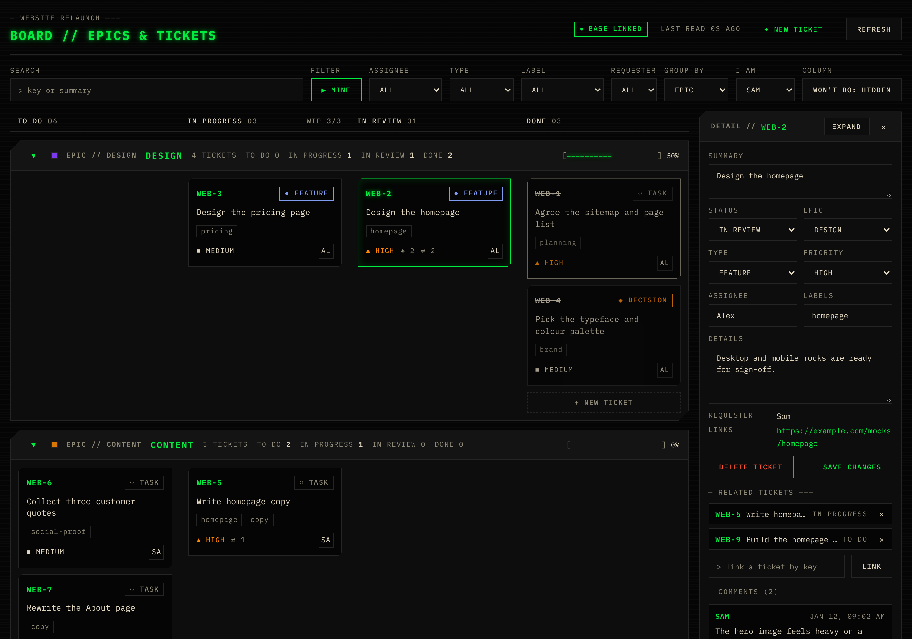

# Swimlane Board for Claude + Airtable

A Jira-style board that runs as a Claude artifact and keeps its data in a free Airtable base. Epics are swim lanes, statuses are columns, tickets are cards you drag.

I built this because I wanted Jira's epic swimlanes without Jira. It took a few sessions of talking to Claude. This kit lets you skip them.

## What you get

- **Swim lanes by epic**, with a progress bar and a count per status on every lane
- **Drag and drop** between columns (status), between lanes (epic), and within a cell (order)
- **Ticket detail panel** that expands to a full overlay: summary, status, epic, type, priority, assignee, labels, details
- **Comments** on every ticket, with drafts saved as you type
- **Related tickets**, linked in both directions
- **Filters**: search, Mine, assignee, type, label, requester, plus group-by-assignee
- **WIP limits** per column, set in Airtable
- **Create and delete** tickets from the board
- **Works on a phone**, one status column at a time
- **Shared with your team through Airtable**, with no Claude Team plan needed

Your data lives in your own Airtable base. The board is a single HTML file with no server behind it. Claude's Airtable connector does the reading and writing, using your Airtable sign-in.

## What's in the kit

| File | What it is |
|---|---|
| `README.md` | This file. For you. |
| `CLAUDE.md` | Setup instructions. For Claude. |
| `board.html` | The board itself. |
| `themes/scifi.css` | The board's look. Add more files here to offer more themes. |
| `sample-data/schema.json` | The four tables and their fields. |
| `sample-data/*.csv` | A small sample project, "Website Relaunch": 4 epics, 14 tickets, 3 comments. |
| `preview.png` | The screenshot above. |

## Setup: about ten minutes

### 1. Get a free Airtable account

Sign up at [airtable.com](https://airtable.com). The Free plan is enough. Airtable creates a first workspace for you during sign-up; the board's base will live there.

### 2. Add the Airtable connector to Claude

In Claude, open your connectors list. Depending on your version of the app this is under **Settings → Connectors** or **Customize → Connectors**. Find **Airtable**, add it, and sign in to Airtable when asked.

Airtable then asks what Claude may access. Choose your workspace (or "everything you have access to"). Claude needs access to the workspace so it can create the new base there.

Airtable's connector is included on all Airtable plans, Free included.

### 3. Upload this kit to Claude and ask for setup

Start a new chat, attach the zip, and say:

> Set up this board for me. Follow CLAUDE.md.

Claude will ask for a project name and a short ticket prefix (the sample uses `WEB`, giving `WEB-1`, `WEB-2`…), and whether you want the sample project loaded or an empty board. It then creates the Airtable base, fills it, points the board at it, and publishes the board as an artifact.

### 4. Open the board

Open the artifact Claude publishes. The first time, Claude asks whether the board may use Airtable. Allow it. The badge at the top right turns to **Base linked** and the lanes fill in.

Set the **I am** menu to your name. It signs your comments and drives the **Mine** filter.

## Sharing the board with other people

Sharing happens in Airtable, which is why nobody needs a Claude Team plan. Each person runs their own copy of the board in their own Claude, and every copy reads and writes the same Airtable base. A change in one copy appears in the others within a couple of minutes.

**What you do, once per person:**

1. Open the base in Airtable and press **Share** at the top right.
2. Invite them by email with **Editor** permission. Editors can add and change tickets. Commenter and Read-only collaborators can open the board and will be unable to change anything.
3. Send them three things: this README, the configured `board.html` that Claude gave you at the end of setup, and the `themes/` folder. That `board.html` already points at your base.

You can invite people to the single base or to the whole workspace. Invite to the **base** unless you want them to see everything else in the workspace.

**What they do:**

1. Accept the Airtable invitation. A free Airtable account is fine.
2. Add the Airtable connector to their Claude (step 2 above), granting it access to the shared base.
3. Start a chat, attach your configured `board.html`, the theme files and `CLAUDE.md`, and say: *"I'm joining an existing board. Follow CLAUDE.md."*
4. Open the artifact, allow Airtable, and set **I am**.

**Free plan limits worth knowing.** Airtable's Free plan allows 5 collaborators with Editor or Creator permission per workspace, 1,000 records per base, and unlimited Read-only collaborators. For a team of up to five, the Free plan covers it. Check [Airtable's plans page](https://support.airtable.com/docs/airtable-plans) for current numbers.

**When the board is updated.** If you change `board.html` or a theme, send the new files to your teammates and have each ask Claude to republish it to their existing artifact. Their settings carry over.

## Using the board

- **Move a ticket:** drag it to another column or lane. On a phone, change Status or Epic in the detail panel.
- **Reorder:** drop a card onto another card to place it above.
- **Add a ticket:** **+ New ticket** in the header, or the button that appears at the bottom of any cell.
- **Edit:** click a card. **Expand** gives you room to write. **Save changes** saves the fields; comments and related links save on their own.
- **Delete:** **Delete ticket** in the detail panel, then confirm. Its comments go with it.
- **Won't Do:** a hidden fifth status for things you decided against. Toggle the column from the toolbar.

## Making it yours

All of this is plain data in Airtable. Edit it there and press **Refresh** on the board.

| To change | Do this in Airtable |
|---|---|
| Add an epic | Add a row to **Epics**: a short key, a name, a hex colour, a lane order |
| Rename or reorder lanes | Edit **Epic** or **Lane Order** in **Epics** |
| Set a WIP limit | Put a number in **WIP Limit** on that row of **Statuses** |
| Add or rename a column | Edit **Statuses**, then add the same name to the Status choices in **Tickets** |
| Hide a column | Untick **Show As Column** |

Or skip the clicking and ask Claude, which can do all of it through the same connector.

### Themes

The board's look comes from a theme file in `themes/`. It ships with one, **scifi**: green on black, a monospace face, scanlines and notched corners. `board.html` holds only the layout, so a theme can change colours, fonts, glows and corners without breaking anything.

To add a theme, copy `themes/scifi.css`, rename it (say `themes/paper.css`), and change the values. Each one is explained in the file. Then add the name to `THEMES` in the `CONFIG` block of `board.html` and republish. Once there are two or more, a **Theme** menu appears in the toolbar. Each person's choice is remembered in their own browser.

Or ask Claude: *"Add a light theme called paper with a blue accent and rounded corners."*

## Things to ask Claude once it's running

Claude can work on the base directly in chat, so the board and the conversation stay in step.

- "Add a ticket to the Build epic: the footer links are broken on mobile. High priority, assign it to Jo."
- "Here's an email from a client. Break it into tickets and put them in the right epics."
- "Summarize where the Launch epic stands and what's blocking it."
- "What's assigned to me that isn't done?"
- "Move everything in In Review that's older than a week back to In Progress."
- "Add an epic called Analytics and move WEB-12 into it."
- "Change the board's accent colour to amber." (Claude edits the theme file and republishes.)

## Good to know

- **Refresh rate.** The board re-reads tickets and comments every two minutes, and immediately after any change you make. `POLL_SECONDS` near the top of the script in `board.html` controls this; `0` turns polling off and leaves the Refresh button.
- **Airtable API allowance.** Airtable's Free plan lists 1,000 API calls per workspace per month, and its connector runs on the same API. Whether connector calls count against that allowance is something I could not confirm. If the board stops loading partway through a month, raise `POLL_SECONDS` or set it to `0`.
- **Two people, one ticket.** If someone else changes a ticket while you are editing it, your save is cancelled, the ticket reloads, and you make the edit again. Edits to different tickets never collide.
- **Deleting is real.** A deleted ticket and its comments are removed from the base. The board asks you to confirm first.
- **Privacy.** The artifact is private to you until you share it. The page holds no ticket data in its source; everything is read from Airtable when it opens. Your browser keeps a snapshot of the last read so the board can draw quickly.

## Troubleshooting

| What you see | What to do |
|---|---|
| "Setup not finished" | The board has no base ID. Ask Claude to follow CLAUDE.md. |
| "No Airtable connector here" | Add or reconnect Airtable in Claude's connectors, then press Refresh. |
| "Not allowed in this view" | Press Refresh and allow Airtable when asked. |
| "Setup problem: no table named…" | A table or field was renamed in Airtable. The board finds them by name: Tickets, Comments, Epics, Statuses. Rename it back, or ask Claude to fix it. |
| "Airtable refused the change" | Your Airtable permission on the base is Commenter or Read-only. Ask the owner for Editor. |
| A teammate sees an empty board | Their connector has no access to the base. They re-authorize Airtable in Claude and include the shared base. |
| Drag does nothing on a phone | Touch devices change status and epic from the detail panel. |

## Requirements

- A Claude plan that can publish artifacts and use connectors
- An Airtable account on any plan
- The Airtable connector added in Claude

## Credits

The scifi theme follows the cassette-futurism style of [scificn/ui](https://www.scificn.dev/), rebuilt by hand in plain CSS. Board, kit, and docs were built with Claude.
